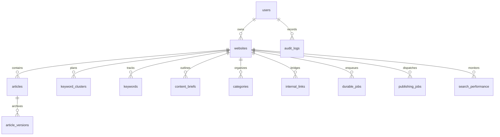

# APEX SEO ENGINE — FINAL MONGODB ARCHITECTURE SPECIFICATION
## Pre-Phase A Architectural Blueprint

- **Document**: `docs/architecture/MONGODB_FINAL_ARCHITECTURE.md`
- **Project**: Apex SEO Engine (`https://apexseoengine.vercel.app/`)
- **Status**: APPROVED ARCHITECTURE BLUEPRINT — INSPECTION & DOCUMENTATION ONLY
- **Target Stack**: Next.js 15 + MongoDB Native Driver (`mongodb` ^6.x) + Zod Runtime Validation
- **Hosting Targets**: Vercel Serverless (Functions & Edge) + MongoDB Atlas (M0 / Dedicated) or Self-Hosted Replica Set

---

## 1. Architectural Philosophy & Decisions

### 1.1 Why Native MongoDB Driver (`mongodb`) Over Mongoose
1. **Next.js 15 & Vercel Serverless Optimization**:
   - `mongodb` utilizes an ultra-lightweight client singleton that eliminates connection re-instantiation overhead and prevents connection pool exhaustion in serverless warm-container lifecycles.
   - Mongoose introduces schema recompilation warnings during Next.js Turbopack / HMR updates, requires `bufferCommands: false` to avoid serverless hangs, and carries significant memory overhead.
2. **Single Source of Truth for Schemas (Zod)**:
   - Apex SEO Engine already relies on Zod (`zod@^3.23.8`) for strict API validation, domain parsing, and LLM structured outputs.
   - Using the Native Driver allows direct mapping:
     $$\text{Zod Schema} \longrightarrow \text{TypeScript Inferred Type} \longrightarrow \text{MongoDB Collection Document}$$
   - Eliminates triple-maintenance of TypeScript interfaces, Mongoose schemas, and Zod schemas.
3. **Atomic Operations & Concurrency**:
   - Unrestricted access to MongoDB atomic operators: `$set`, `$inc`, `$push`, `$pull`, `$setOnInsert`, and `findOneAndUpdate`.
   - Crucial for race-free worker job claiming (`durable_jobs`) and bullion cache mutex locks (`finance_gold_cache`).

---

## 2. Comprehensive Collection Architecture (24 Models Evaluated)

### 2.1 Critical Decision: Embedding vs. Referencing

| Model | Target Architecture | Rationale & Boundaries |
| :--- | :--- | :--- |
| **`ArticleVersion`** | **SEPARATE COLLECTION** (`article_versions`) | **Do NOT embed in `articles`**. Full pillar articles contain 2,000–5,000 words (20KB–50KB per version). Embedding 20–50 versions inside a single article document would rapidly approach MongoDB's 16MB limit, bloat memory during indexing, and penalize read-heavy public card queries (`/p/[websiteId]`). |
| **`ArticleImage`** | **EMBEDDED ARRAY** inside `articles.images` | Maximum 3–8 images per article. Metadata per image is $<200$ bytes. Images are always queried with the article. (SVG Data URIs or image CDN URLs). |
| **`User`, `Role`, `Permission`** | **`users` (Discrete) + `roles` (Discrete)** | Roles and permissions are relatively static but shared across tenants. Users reference `roleId` and cache `roleName` + `permissions: string[]` inside the user session token. |
| **`WebsiteIntegration`** | **EMBEDDED ARRAY** inside `websites.integrations` | Typically 1–4 integrations per website (WordPress, Webflow, Custom). Always fetched when publishing or validating credentials. |
| **`InternalLink`** | **SEPARATE COLLECTION** (`internal_links`) | Critical for bidirectional graph traversal (`IncomingArticleLinks` vs `OutgoingArticleLinks`), topical cluster mapping, orphan page queries, and independent status transitions (`SUGGESTED` $\rightarrow$ `APPROVED` $\rightarrow$ `INSERTED`). |
| **`Keyword` & `KeywordCluster`** | **SEPARATE COLLECTIONS** | A single cluster may contain 50–500 keywords. Referencing ensures high-performance pagination, filtering by difficulty/CPC, and GSC tracking updates. |

---

### 2.2 Complete 18-Collection Inventory & Document Specifications



#### 1. `users`
- **Fields**: `_id` (string UUID), `email` (string), `name` (string), `passwordHash` (string), `isActive` (boolean), `mustChangePassword` (boolean), `tokenVersion` (int), `lastLoginAt` (date), `passwordChangedAt` (date), `roleId` (string), `createdAt` (date), `updatedAt` (date).
- **Indexes**:
  - `email`: `{ email: 1 }` (UNIQUE, collation `{ locale: "en", strength: 2 }`).
  - `roleId`: `{ roleId: 1 }`.

#### 2. `roles` & `permissions`
- **`roles`**: `_id`, `name` (unique: "ADMIN", "EDITOR", "VIEWER"), `description`, `permissions` (array of string codes e.g. `["content:write", "analytics:read"]`).
- **`permissions`**: `_id`, `code` (unique: "content:write"), `module`, `description`.

#### 3. `websites`
- **Fields**: `_id` (string UUID), `ownerId` (string - references `users._id`), `name` (string), `url` (string), `cmsType` (string), `status` (string), `publishingConfig` (object), `seoConfig` (object), `integrations` (array of embedded objects: `{ id, integrationType, name, endpointUrl, encryptedCredentials, config, status, lastSyncedAt }`), `createdAt` (date), `updatedAt` (date).
- **Indexes**:
  - `url`: `{ url: 1 }` (UNIQUE).
  - `ownerId`: `{ ownerId: 1 }` (Tenant isolation root).
  - `status`: `{ status: 1 }`.

#### 4. `categories`
- **Fields**: `_id`, `websiteId` (string), `name` (string), `slug` (string), `description` (string), `parentId` (string nullable), `createdAt`, `updatedAt`.
- **Indexes**:
  - Compound: `{ websiteId: 1, slug: 1 }` (UNIQUE).
  - Parent: `{ websiteId: 1, parentId: 1 }`.

#### 5. `keyword_clusters`
- **Fields**: `_id`, `websiteId`, `name`, `pillarKeyword`, `intent`, `status`, `createdAt`, `updatedAt`.
- **Indexes**:
  - Compound: `{ websiteId: 1, status: 1 }`.

#### 6. `keywords`
- **Fields**: `_id`, `websiteId`, `clusterId` (nullable), `term` (string), `searchIntent`, `searchVolume` (int), `difficulty` (float), `cpc` (float), `currentPosition` (float nullable), `status`, `createdAt`, `updatedAt`.
- **Indexes**:
  - Compound: `{ websiteId: 1, term: 1 }` (UNIQUE).
  - Cluster: `{ websiteId: 1, clusterId: 1 }`.

#### 7. `content_briefs`
- **Fields**: `_id`, `websiteId`, `keywordId` (nullable), `clusterId` (nullable), `title`, `targetWordCount`, `searchIntent`, `outline` (JSON/Array of structured section objects), `secondaryKeywords` (array of strings), `competitorNotes`, `status`, `createdAt`, `updatedAt`.
- **Indexes**:
  - Compound: `{ websiteId: 1, status: 1 }`.

#### 8. `articles`
- **Fields**: `_id`, `websiteId`, `categoryId` (nullable), `briefId` (nullable), `authorId` (nullable), `title`, `slug`, `excerpt`, `content` (Markdown text), `status` ("DRAFT" | "NEEDS_REVIEW" | "APPROVED" | "PUBLISHED"), `focusKeyword`, `metaTitle`, `metaDescription`, `canonicalUrl`, `seoScore` (int 0–100), `wordCount` (int), `externalPostId`, `publishedUrl`, `publishedAt`, `images` (array of embedded objects: `{ id, url, altText, caption, isFeatured, width, height, provider }`), `createdAt`, `updatedAt`.
- **Indexes**:
  - Compound: `{ websiteId: 1, slug: 1 }` (UNIQUE).
  - Query Filter: `{ websiteId: 1, status: 1 }`.
  - Author: `{ authorId: 1 }`.

#### 9. `article_versions` (Separate Collection for Document Size Safety)
- **Fields**: `_id`, `articleId` (string), `websiteId` (string - denormalized for direct tenant filtering), `versionNumber` (int), `title`, `content` (Markdown), `metaTitle`, `metaDesc`, `changeSummary`, `createdBy`, `createdAt`.
- **Indexes**:
  - Compound: `{ articleId: 1, versionNumber: -1 }` (UNIQUE).
  - Tenant: `{ websiteId: 1, articleId: 1 }`.

#### 10. `internal_links`
- **Fields**: `_id`, `websiteId`, `sourceArticleId`, `targetArticleId`, `anchorText`, `targetUrl`, `status` ("SUGGESTED" | "APPROVED" | "INSERTED" | "REJECTED" | "REMOVED"), `relevanceScore` (float), `createdAt`, `updatedAt`.
- **Indexes**:
  - Compound: `{ websiteId: 1, status: 1 }`.
  - Outgoing: `{ sourceArticleId: 1 }`.
  - Incoming: `{ targetArticleId: 1 }`.
  - Uniqueness: `{ sourceArticleId: 1, targetArticleId: 1, anchorText: 1 }` (Prevent duplicate recommendations).

#### 11. `publishing_jobs`
- **Fields**: `_id`, `websiteId`, `articleId`, `cmsType`, `status`, `scheduledFor`, `publishedAt`, `errorMessage`, `publishResult` (object), `createdAt`, `updatedAt`.
- **Indexes**:
  - Compound: `{ websiteId: 1, status: 1, scheduledFor: 1 }`.

#### 12. `durable_jobs`
- **Fields**: `_id`, `websiteId`, `jobType`, `status` ("PENDING" | "PROCESSING" | "COMPLETED" | "FAILED" | "CANCELLED"), `priority` (int), `payload` (object), `result` (object nullable), `attempts` (int), `maxAttempts` (int), `runAt` (date), `lockedAt` (date nullable), `lockedBy` (string nullable), `lastError` (string nullable), `createdAt`, `updatedAt`.
- **Indexes**:
  - Work Queue: `{ status: 1, runAt: 1, priority: -1 }`.
  - Tenant: `{ websiteId: 1, jobType: 1 }`.

#### 13. `job_schedules` & `scheduler_runs`
- **`job_schedules`**: `_id`, `name` (unique), `cronExpression`, `jobType`, `websiteId` (nullable), `payload`, `isActive`, `lastRunAt`, `nextRunAt`.
- **`scheduler_runs`**: `_id`, `status`, `triggeredAt`, `durationMs`, `jobsEnqueued`, `details`.

#### 14. `automation_workflows` & `automation_executions`
- **`automation_workflows`**: `_id`, `websiteId`, `name`, `triggerType`, `actions` (array), `filters` (object), `isEnabled`.
- **`automation_executions`**: `_id`, `workflowId`, `status`, `startedAt`, `finishedAt`, `logs` (array).

#### 15. `ai_providers` & `ai_models`
- **`ai_providers`**: `_id`, `name` (unique), `providerType`, `baseUrl`, `encryptedApiKey`, `isLocal`, `isEnabled`, `status`, `config`.
- **`ai_models`**: `_id`, `providerId`, `name`, `modelId`, `capabilities` (array), `contextWindow`, `temperature`, `isDefault`. (Unique: `{ providerId: 1, modelId: 1 }`).

#### 16. `search_performance`
- **Fields**: `_id`, `websiteId`, `articleId` (nullable), `keywordId` (nullable), `date` (string YYYY-MM-DD), `pagePath`, `keywordTerm`, `impressions`, `clicks`, `ctr`, `position`.
- **Indexes**:
  - Compound: `{ websiteId: 1, date: 1, pagePath: 1, keywordTerm: 1 }` (UNIQUE).

#### 17. `system_settings`
- **Fields**: `_id`, `category`, `key` (unique), `value` (any object/primitive), `isSecret`, `description`, `updatedAt`.

#### 18. `audit_logs`
- **Fields**: `_id`, `userId` (nullable), `action`, `module`, `entityType`, `entityId`, `ipAddress`, `userAgent`, `metadata` (object), `createdAt` (date).
- **Indexes**:
  - Lookup: `{ entityId: 1, action: 1 }`.
  - Timestamp: `{ createdAt: -1 }`.
  - TTL (Optional 90-day retention): `{ createdAt: 1 }, { expireAfterSeconds: 7776000 }`.

---

## 3. Connection Pooling & Serverless Strategy (Next.js 15 / Vercel)

```typescript
// src/lib/mongodb.ts
import { MongoClient, Db } from "mongodb";

declare global {
  var _mongoClientPromise: Promise<MongoClient> | undefined;
}

const uri = process.env.MONGODB_URI || "";
if (!uri) {
  throw new Error("MONGODB_URI environment variable is missing.");
}

const options = {
  maxPoolSize: 10, // Ideal for serverless lambdas
  minPoolSize: 1,
  serverSelectionTimeoutMS: 5000,
  connectTimeoutMS: 10000,
  socketTimeoutMS: 30000
};

let clientPromise: Promise<MongoClient>;

if (process.env.NODE_ENV === "development") {
  if (!global._mongoClientPromise) {
    const client = new MongoClient(uri, options);
    global._mongoClientPromise = client.connect();
  }
  clientPromise = global._mongoClientPromise;
} else {
  const client = new MongoClient(uri, options);
  clientPromise = client.connect();
}

export async function getDb(dbName = "apex_seo"): Promise<Db> {
  const client = await clientPromise;
  return client.db(dbName);
}
```

### Multi-Tenant Query Wrapper
To prevent developer error and ensure absolute tenant isolation:
```typescript
export function tenantQuery(websiteId: string, filter: Record<string, unknown> = {}) {
  if (!websiteId) throw new Error("Security violation: websiteId is required for tenantQuery");
  return { ...filter, websiteId };
}
```

---

## 4. Durable Job Queue Concurrency & Worker Lease Strategy

In serverless and multi-worker environments, duplicate task execution is prevented using MongoDB atomic `findOneAndUpdate`:

```typescript
// Atomic Lease Claiming
const leaseDurationMs = 5 * 60 * 1000; // 5-minute lock
const now = new Date();
const lockExpiration = new Date(now.getTime() - leaseDurationMs);

const claimedJob = await db.collection("durable_jobs").findOneAndUpdate(
  {
    status: { $in: ["PENDING", "FAILED"] },
    runAt: { $lte: now },
    attempts: { $lt: 5 }, // max attempts guard
    $or: [
      { lockedAt: null },
      { lockedAt: { $lte: lockExpiration } } // Crash recovery: reclaimed expired lease
    ]
  },
  {
    $set: {
      status: "PROCESSING",
      lockedAt: now,
      lockedBy: workerInstanceId
    },
    $inc: { attempts: 1 }
  },
  {
    sort: { priority: -1, runAt: 1 },
    returnDocument: "after"
  }
);
```
- **Dead-Letter Handling**: If `attempts >= maxAttempts` (e.g. 5), job status transitions to `"DEAD_LETTER"` and emits an alert to `audit_logs`.
- **Worker Crash Recovery**: If a worker abruptly crashes or Vercel times out at 30 seconds, the job remains in `"PROCESSING"` until `lockedAt < (now - 5min)`, at which point another worker safely reclaims it.

---

## 5. Pakistan Gold Rate Shared Cache Redesign

### Collection: `finance_gold_cache`
```typescript
interface GoldCacheDocument {
  _id: string; // "islamabad"
  citySlug: string;
  cityName: string;
  data: PakistanGoldRatesResult;
  cachedAt: Date;
  expiresAt: Date;
  // Concurrency & Quota Mutex
  lockedUntil: Date | null;
  lockedBy: string | null;
  remainingDailyQuota: number | null;
}
```

### Concurrency & Quota Guarantee Architecture
1. **Cache Hit**: If `new Date() < doc.expiresAt`, immediately return `doc.data` (0 network calls).
2. **Atomic Mutex on Expiry (Single-Flight Across Vercel Instances)**:
   ```typescript
   const lockTimeout = new Date(Date.now() + 10_000); // 10s mutex
   const lockClaimed = await db.collection("finance_gold_cache").findOneAndUpdate(
     {
       _id: citySlug,
       $or: [
         { expiresAt: { $lte: new Date() }, lockedUntil: { $in: [null, { $lte: new Date() }] } },
         { lockedUntil: null }
       ]
     },
     { $set: { lockedUntil: lockTimeout, lockedBy: process.pid.toString() } }
   );
   ```
3. **If lock claimed**: Exactly ONE instance executes `fetch("https://api.sarafa.pk/...")`, writes new data, updates `expiresAt = now + 15min`, releases lock, and records remaining quota.
4. **If lock failed**: Another instance is already fetching; immediately return existing data with `isStale: true` and `staleReason: "Refreshing in background"`.
5. **Quota Protection**: If `remainingDailyQuota <= 5`, the lock claim is bypassed entirely, serving cached data with `isStale: true` until quota resets.
6. **TTL Index**: `{ expiresAt: 1 }, { expireAfterSeconds: 86400 }` (Used strictly for cleaning up obsolete cities after 24h of inactivity; freshness is strictly validated via `doc.expiresAt`).
