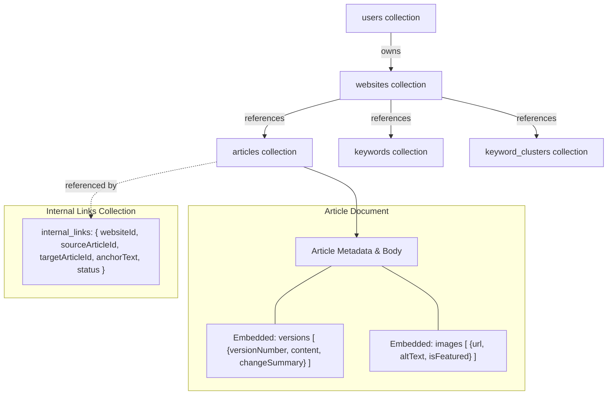

# APEX SEO ENGINE — DATABASE ARCHITECTURE INSPECTION REPORT
## Full Audit & Phased MongoDB Migration Master Plan

- **Timestamp**: 2026-11-14T12:17:00+05:00
- **Document**: `docs/architecture/MONGODB_MIGRATION_INSPECTION_REPORT.md`
- **Objective**: Complete architecture inspection and production migration roadmap from PostgreSQL to MongoDB
- **Status**: INSPECTION ONLY — NO CODE OR PRODUCTION STATE ALTERED

---

## 1. Executive Summary & Objective

The intended primary database architecture for Apex SEO Engine is **MongoDB**, not PostgreSQL. Currently, the platform operates on PostgreSQL via Prisma ORM (`@prisma/client`), utilizing `@electric-sql/pglite` for embedded local developer socket simulation and standard PostgreSQL connections on Vercel (`vercel.json`).

This inspection report provides:
1. A complete inventory of all 24 PostgreSQL models, relationships, unique constraints, and indexes.
2. An audit of all PostgreSQL-specific assumptions (`@prisma/adapter-pg`, `pglite`, relational cascade constraints, JSON column handling).
3. A technical evaluation between the **Native MongoDB Driver (`mongodb`)** and **Mongoose ODM**, recommending the ideal zero-cost, Next.js 15 / Vercel serverless stack.
4. Complete document model redesigns (handling embedded vs. referenced documents, tenant isolation, and atomic operations).
5. A specialized MongoDB redesign for the **Pakistan Gold Rate shared cache & quota protection engine**.
6. An 8-phase safe migration plan with risk mitigation and zero downtime rollback strategies.

---

## 2. Current PostgreSQL Architecture Inventory

### 2.1 The 24 Relational Models Inventory

| Model Name | Primary Relational Dependencies | Indexes & Unique Constraints | Stored JSON Columns |
| :--- | :--- | :--- | :--- |
| **`User`** | `Role` (N:1), `Website` (1:N), `Article` (1:N), `AuditLog` (1:N) | `unique(email)`, `index(roleId)` | None |
| **`Role`** | `User` (1:N), `Permission` (M:N via implicit/explicit mapping) | `unique(name)` | `permissions: Json` (array of codes) |
| **`Permission`** | RBAC permission codes | `unique(code)`, `index(module)` | None |
| **`Website`** | `User` (N:1), `WebsiteIntegration` (1:N), `Article` (1:N), `Keyword` (1:N), `KeywordCluster` (1:N), `ContentBrief` (1:N), `Category` (1:N), `InternalLink` (1:N), `PublishingJob` (1:N), `DurableJob` (1:N) | `unique(url)`, `index(ownerId)`, `index(cmsType)` | `publishingConfig`, `seoConfig` |
| **`WebsiteIntegration`** | `Website` (N:1) | `unique(websiteId, integrationType)` | `config: Json` |
| **`AIProvider`** | `AIModel` (1:N) | `unique(name)`, `index(providerType)` | `config: Json` |
| **`AIModel`** | `AIProvider` (N:1) | `unique(providerId, modelId)` | `capabilities: Json` |
| **`KeywordCluster`**| `Website` (N:1), `Keyword` (1:N), `ContentBrief` (1:N) | `index(websiteId)`, `index(status)` | None |
| **`Keyword`** | `Website` (N:1), `KeywordCluster` (N:1), `ContentBrief` (1:N), `SearchPerformance` (1:N) | `unique(websiteId, term)`, `index(clusterId)` | None |
| **`ContentBrief`** | `Website` (N:1), `Keyword` (N:1), `KeywordCluster` (N:1), `Article` (1:N) | `index(websiteId)`, `index(keywordId)` | `outline: Json`, `secondaryKeywords: Json` |
| **`Category`** | `Website` (N:1), Self-relation `parent`/`children` (1:N), `Article` (1:N) | `unique(websiteId, slug)` | None |
| **`Article`** | `Website` (N:1), `Category` (N:1), `ContentBrief` (N:1), `User` (N:1), `ArticleVersion` (1:N), `ArticleImage` (1:N), `InternalLink` (Incoming/Outgoing) | `unique(websiteId, slug)`, `index(websiteId, status)` | None (Markdown text) |
| **`ArticleVersion`**| `Article` (N:1) | `unique(articleId, versionNumber)` | None |
| **`ArticleImage`** | `Article` (N:1) | `index(articleId)` | None |
| **`InternalLink`** | `Website` (N:1), `sourceArticle` (N:1), `targetArticle` (N:1) | `index(websiteId)`, `index(sourceArticleId)`, `index(targetArticleId)` | None |
| **`PublishingJob`**| `Website` (N:1), `Article` (N:1) | `index(websiteId)`, `index(status)` | `publishResult: Json` |
| **`AutomationWorkflow`**| `Website` (N:1), `AutomationExecution` (1:N) | `index(websiteId)`, `index(triggerType)` | `actions: Json`, `filters: Json` |
| **`AutomationExecution`**| `AutomationWorkflow` (N:1) | `index(workflowId)`, `index(status)` | `logs: Json` |
| **`DurableJob`** | `Website` (N:1) | `index(websiteId)`, `index(status)`, `index(jobType)` | `payload: Json`, `result: Json` |
| **`JobSchedule`** | Background cron definitions | `unique(name)`, `index(isActive)` | `payload: Json` |
| **`SchedulerRun`** | Execution heartbeats | `index(status)`, `index(triggeredAt)` | `details: Json` |
| **`SearchPerformance`**| `Website` (N:1), `Article` (N:1), `Keyword` (N:1) | `unique(websiteId, date, pagePath, keywordTerm)` | None |
| **`SystemSetting`**| Global key-value store & cache | `unique(key)`, `index(category)` | `value: Json` |
| **`AuditLog`** | `User` (N:1) | `index(userId)`, `index(module)`, `index(action)` | `metadata: Json` |

### 2.2 PostgreSQL-Specific Implementations & Assumptions

1. **`src/lib/db.ts` & Local PGlite Socket Daemon**:
   - Spawns an in-process PostgreSQL socket server (`@electric-sql/pglite` and `@electric-sql/pglite-socket`) for local development on `127.0.0.1:5432`.
   - Executes raw DDL: `SELECT EXISTS (SELECT FROM information_schema.tables WHERE ...)` and loads SQL from `prisma/migrations/20261112000000_init_phase01/migration.sql`.
2. **`vercel.json` Build Command**:
   - Specifies: `"buildCommand": "prisma generate && prisma migrate deploy && next build"`.
   - Fails if connected to a MongoDB connection string because `prisma migrate deploy` is only supported on relational databases (PostgreSQL, MySQL, SQLite, CockroachDB).
3. **Database Driver Imports**:
   - `pg` (`pg.Pool`), `@prisma/adapter-pg`.
4. **Relational Cascade Rules**:
   - Models heavily declare `onDelete: Cascade` (e.g. `Website` $\rightarrow$ `Articles`, `Keywords`, `Clusters`, `Jobs`; `Article` $\rightarrow$ `Versions`, `Images`, `Links`). In MongoDB, cascades must be handled either by embedding child documents or by transactional deletion logic.

---

## 3. Target MongoDB Architecture: Native Driver vs. Mongoose

### 3.1 Comparison Matrix

| Evaluation Criteria | Option A: Native MongoDB Driver (`mongodb`) | Option B: Mongoose ODM |
| :--- | :--- | :--- |
| **Next.js 15 & Serverless (Vercel)** | **Superior**. Zero connection overhead, highly efficient connection caching using global singleton pattern. | Known schema-recompilation quirks in Next.js Turbopack / HMR; heavier cold-start footprint. |
| **Type Safety & Validation** | **Superior when paired with Zod**. We already use Zod everywhere in the project (`zod@^3.23.8`). Zod schemas provide runtime validation + compile-time TypeScript types without duplicate Mongoose schemas. | Mongoose schemas duplicate TypeScript interfaces and Zod schemas, creating triple-maintenance overhead. |
| **Atomic Operations** | Full native support for `$set`, `$inc`, `$push`, `$pull`, `findOneAndUpdate`, `$setOnInsert`. | Supported via wrapper functions. |
| **Connection Pooling** | Native `MongoClient` handles pooling and connection reuse across warm serverless lambdas seamlessly. | Requires strict `bufferCommands: false` and manual connection state monitoring. |
| **Multi-Tenant Isolation** | Straightforward collection querying with strict `{ websiteId }` or `{ ownerId }` query filters. | Plugin required or manual pre-find hooks. |
| **Zero-Cost Development** | 100% free; compatible with local MongoDB or free MongoDB Atlas M0 cluster. | 100% free. |

### 3.2 Recommendation: Option A (Native MongoDB Driver + Zod)
**We officially recommend Option A: Native MongoDB Driver (`mongodb`) coupled with our existing Zod domain schemas.**
- Prevents redundant schema definitions.
- Zero serverless cold-start penalties on Vercel.
- Direct alignment with Next.js 15 App Router architecture.
- Full support for atomic operations (`$set`, `$inc`, `findOneAndUpdate`) essential for rate-limiting, job leasing, and cache management.

---

## 4. Document Model Redesign (Document-Oriented Mapping)

In MongoDB, we replace rigid relational tables with document patterns that leverage **embedding** for 1:N items that are always read together, while retaining **references** for independently queried entities.

### 4.1 Embedded vs. Referenced Strategy



### 4.2 Document Collection Specifications

1. **`users` Collection**:
   - `_id`: `ObjectId` or UUID string.
   - `email`: String (Unique index).
   - `name`, `passwordHash`, `isActive`, `mustChangePassword`, `tokenVersion`, `lastLoginAt`, `passwordChangedAt`.
   - `role`: Embedded object `{ name: "ADMIN", permissions: ["*"] }` (eliminates relational `Role` join).
2. **`websites` Collection**:
   - `_id`: UUID or string ID.
   - `ownerId`: String (Index).
   - `name`, `url` (Unique index), `cmsType`, `status`.
   - `publishingConfig`, `seoConfig`.
   - `integrations`: Embedded array `[ { integrationType, name, endpointUrl, encryptedCredentials, status } ]`.
3. **`articles` Collection**:
   - `_id`: String ID.
   - `websiteId`: String (Compound index `{ websiteId: 1, slug: 1 }` unique, `{ websiteId: 1, status: 1 }`).
   - `title`, `slug`, `excerpt`, `content` (Markdown), `focusKeyword`, `seoScore`, `wordCount`, `status`.
   - `versions`: Embedded array of objects `[ { versionNumber, content, metaTitle, changeSummary, createdAt } ]` (Capped at last 20 revisions to maintain optimal document size $< 2\text{MB}$).
   - `images`: Embedded array `[ { url, altText, isFeatured, width, height } ]`.
4. **`keyword_clusters` & `keywords` Collections**:
   - `keyword_clusters`: `{ _id, websiteId, name, pillarKeyword, intent, status }`.
   - `keywords`: `{ _id, websiteId, clusterId, term, searchIntent, searchVolume, difficulty, cpc }` (Unique index `{ websiteId: 1, term: 1 }`).
5. **`internal_links` Collection**:
   - Kept as a discrete collection for high-speed graph aggregation:
   - `{ _id, websiteId, sourceArticleId, targetArticleId, anchorText, targetUrl, status, relevanceScore }`.
   - Compound indexes: `{ websiteId: 1, status: 1 }`, `{ sourceArticleId: 1 }`, `{ targetArticleId: 1 }`.
6. **`durable_jobs` Collection**:
   - `{ _id, websiteId, jobType, status, payload, result, attempts, maxAttempts, runAt, lockedAt, lockedBy }`.
   - Atomic worker leasing using `findOneAndUpdate({ status: "PENDING", runAt: { $lte: new Date() } }, { $set: { status: "PROCESSING", lockedAt: new Date() } })`.
7. **`audit_logs` Collection**:
   - `{ _id, userId, action, module, entityType, entityId, ipAddress, userAgent, metadata, createdAt }`.
   - Index: `{ entityId: 1, action: 1 }`, `{ createdAt: -1 }`.
8. **`system_settings` Collection**:
   - `{ _id, key (unique), category, value, isSecret, description, updatedAt }`.

---

## 5. Pakistan Gold Rate Shared Cache Redesign (MongoDB-Native)

In Phase 02.2, we used `SystemSetting` as a cross-instance cache. Under MongoDB, we redesign this into a high-performance, atomic caching collection:

### 5.1 Collection: `finance_gold_cache`
```typescript
interface GoldCacheDocument {
  _id: string; // citySlug, e.g., "islamabad"
  citySlug: string;
  cityName: string;
  data: PakistanGoldRatesResult;
  cachedAt: Date;
  expiresAt: Date;
  // Concurrency & Quota Guard
  lockUntil?: Date; // Distributed mutex
  lockedBy?: string;
  lastRemainingQuota: number | null;
}
```

### 5.2 Atomic Distributed Lock & Stampede Prevention
To prevent multiple Vercel serverless lambdas from hitting Sarafa.pk when a 15-minute cache window expires:
1. **Atomic Lock Claim**:
   ```typescript
   const lock = await db.collection("finance_gold_cache").findOneAndUpdate(
     {
       _id: citySlug,
       $or: [
         { expiresAt: { $lte: new Date() }, lockUntil: { $exists: false } },
         { lockUntil: { $lte: new Date() } }
       ]
     },
     {
       $set: { lockUntil: new Date(Date.now() + 10_000), lockedBy: instanceId }
     }
   );
   ```
2. **Result**: Only ONE serverless function wins the lock to make the single HTTP request to Sarafa.pk; all other instances immediately read the existing cached document with `isStale: true` until the winner updates the cache.
3. **Application-Level Freshness**:
   - Freshness is determined by `new Date() < doc.expiresAt`.
   - MongoDB TTL Index is applied only for cleanup of abandoned records, never as the freshness decider.

---

## 6. Phased Migration Plan

```mermaid
flowchart LR
    PhaseA["A. DB Abstraction<br/>(mongodb driver)"] --> PhaseB["B. Auth & RBAC<br/>(User & Session)"]
    PhaseB --> PhaseC["C. Tenant & Sites<br/>(Websites & Configs)"]
    PhaseC --> PhaseD["D. Content & SEO<br/>(Articles & Briefs)"]
    PhaseD --> PhaseE["E. Links & Claims<br/>(InternalLink & Audit)"]
    PhaseE --> PhaseF["F. Worker & Jobs<br/>(DurableJob queue)"]
    PhaseF --> PhaseG["G. Gold Rate Cache<br/>(Atomic Lock)"]
    PhaseG --> PhaseH["H. Testing & Cutover<br/>(Full regression)"]
```



### Phase A: Database Abstraction & Connection Factory
- **Files Affected**: `src/lib/mongodb.ts`, `src/lib/db.ts`, `package.json`, `.env.example`.
- **Implementation**:
  - Install `mongodb` package (`^6.x`).
  - Create `src/lib/mongodb.ts` providing cached `MongoClient` singleton optimized for Vercel serverless.
  - Maintain `src/lib/db.ts` facade interface to minimize breaking changes during rollout.
- **Acceptance Criteria**: Connection test passes with connection pooling in local and CI environments.

### Phase B: Authentication, Users & RBAC Migration
- **Files Affected**: `src/lib/auth.ts`, `src/app/api/v1/auth/*`, `src/lib/seed-service.ts`.
- **Implementation**:
  - Migrate `users` and `roles` collections. Embed role permissions directly into the user document.
  - Update password verification, `tokenVersion` checks, and session token creation.
- **Acceptance Criteria**: `tests/unit-security.test.ts` and `tests/security-hardening.test.ts` pass without Prisma.

### Phase C: Website & Tenant Isolation Models
- **Files Affected**: `src/app/api/v1/websites/*`, `src/app/api/v1/integrations/*`.
- **Implementation**:
  - Migrate `websites` collection. Embed `WebsiteIntegration[]` into the website document.
  - Enforce `{ ownerId: user.id }` filters on all tenant queries.
- **Acceptance Criteria**: Multi-website isolation tests pass with zero cross-tenant leaks.

### Phase D: Content, Keywords & Article Generator
- **Files Affected**: `src/app/api/v1/content/*`, `src/services/ai/*`.
- **Implementation**:
  - Migrate `articles`, embedding versions and images.
  - Migrate `keywords` and `keyword_clusters`.
- **Acceptance Criteria**: Modular generation and version snapshot tests pass cleanly.

### Phase E: Internal Linking & Editorial Factual Review
- **Files Affected**: `src/app/api/v1/content/factual-review/*`, `src/services/seo/*`, `src/components/dashboard/FactualReviewPanel.tsx`.
- **Implementation**:
  - Migrate `internal_links` collection and `audit_logs` collection.
  - Rehydrate reviewer decisions from `audit_logs` using MongoDB queries.
- **Acceptance Criteria**: `tests/factual-claim-reviewer.test.ts` and `tests/factual-claim-api.test.ts` pass with 100% fidelity.

### Phase F: Automation Worker & DurableJob Queue
- **Files Affected**: `src/services/automation/*`, `src/app/api/v1/jobs/*`, `src/app/api/v1/scheduler/*`.
- **Implementation**:
  - Migrate `durable_jobs` and `job_schedules`.
  - Implement atomic job leasing via `findOneAndUpdate`.
- **Acceptance Criteria**: `tests/vercel-durable-worker.test.ts` and `tests/external-scheduler.test.ts` pass.

### Phase G: Pakistan Gold Rate Shared Cache
- **Files Affected**: `src/services/finance/pakistan-gold-rate-service.ts`.
- **Implementation**:
  - Migrate from `SystemSetting` to `finance_gold_cache` collection with atomic distributed locking.
- **Acceptance Criteria**: `tests/pakistan-gold-rates.test.ts` and `tests/pakistan-gold-rates-api.test.ts` pass without SQLite or PGlite dependencies.

### Phase H: Full Regression, Cleanup & Vercel Cutover
- **Files Affected**: `vercel.json`, `package.json`, removal of PGlite dependencies.
- **Implementation**:
  - Update `vercel.json` build command to `next build` (removing Prisma migrate deploy).
  - Decommission `@prisma/client`, `@electric-sql/pglite`, `pg`.
- **Acceptance Criteria**: 20/20 test suites pass (122/122 tests), production build exits with code 0.

---

## 7. Data Preservation & Zero-Downtime Cutover Strategy

1. **Pre-Migration Snapshot**:
   - Execute an export script dumping existing PostgreSQL tables (`users`, `websites`, `articles`, `keywords`, `audit_logs`) to structured JSON files.
2. **Transformation Pipeline**:
   - Ingest JSON dump, transform relational IDs into document structures (e.g. nesting `versions` and `images` inside their parent `article`).
   - Validate transformed documents against project Zod schemas.
3. **Dual-Read / Fallback Verification**:
   - Migration script inserts records into MongoDB.
   - Run verification queries checking document count parity ($N_{\text{pg}} = N_{\text{mongo}}$) and hash integrity before switching the primary connection.
4. **Zero Data Loss Guarantee**:
   - The PostgreSQL database is preserved as a read-only archive until MongoDB verification passes 100% acceptance testing.

---

## 8. Vercel & Zero-Cost Compatibility Analysis

- **Hosting & Database Costs**:
  - **MongoDB Atlas**: Free Tier (M0 Sandbox) offers 512 MB storage, shared RAM, and free automated daily backups—more than sufficient for enterprise SEO metadata, text articles, and audit logs.
  - **Zero Paid APIs**: MongoDB Node driver is open source (`Apache-2.0`). No paid plugins, libraries, or proxies needed.
- **Vercel Connection Optimization**:
  - Global `MongoClient` caching avoids connection exhaustion on Vercel Functions.
  - Build time decreases significantly by omitting `prisma generate` and `prisma migrate deploy`.

---

## 9. Stop Condition & Next Action

This audit and migration report is **INSPECTION ONLY**.
- **No application code was modified.**
- **No database schemas or connections were altered.**
- **No packages were installed or removed.**
- **No push to GitHub or deployment to Vercel was executed.**

We halt here and await your explicit approval of this architectural plan before initiating Phase A.
