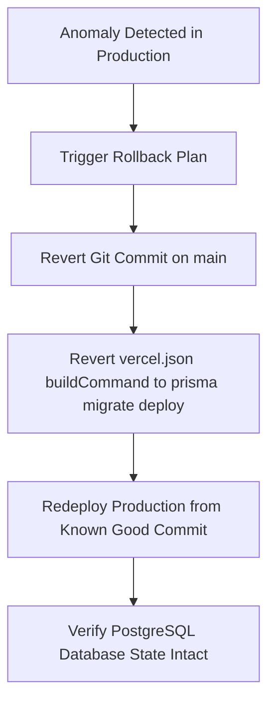

# APEX SEO ENGINE — PRODUCTION MONGODB CUTOVER & ROLLBACK PLAN
## Comprehensive Migration, Data Consistency & Zero-Downtime Strategy

- **Document**: `docs/architecture/MONGODB_PRODUCTION_CUTOVER_PLAN.md`
- **Scope**: Step-by-step production cutover protocol, data preservation, record parity verification, Vercel build adjustments, and contingency rollback.

---

## 1. Pre-Migration Data Export & Preservation Protocol

### 1.1 Read-Only Freeze Window (15 Minutes)
To ensure write consistency without data divergence during migration:
1. Announce a short 15-minute maintenance window for administrative publishing. Public magazine pages (`/p/[websiteId]`) will continue to be served via edge caching.
2. In Vercel Project Settings, disable the scheduled cron trigger (`/api/v1/cron/enqueue-schedules`) temporarily to pause new background jobs.

### 1.2 Full PostgreSQL Export Script
Before touching any production configuration, execute a comprehensive database dump:
```bash
# 1. Full SQL Schema & Data Dump
pg_dump "$DATABASE_URL" -F c -b -v -f ./backups/pre_migration_pg_dump.dump

# 2. Structured JSON Export for every table
npm run db:export-json
```
The JSON export produces a validated directory:
- `backups/json/users.json`
- `backups/json/roles.json`
- `backups/json/websites.json`
- `backups/json/articles.json`
- `backups/json/article_versions.json`
- `backups/json/keywords.json`
- `backups/json/internal_links.json`
- `backups/json/audit_logs.json`
- `backups/json/system_settings.json`

---

## 2. Ingestion & Document Transformation Pipeline

A dedicated zero-cost transformation script (`scripts/migrate-pg-to-mongo.ts`) ingests the JSON backup and loads MongoDB:

### 2.1 Transformation Rules
1. **Websites**:
   - Embeds related `WebsiteIntegration` records into `website.integrations = [...]`.
2. **Articles**:
   - Embeds related `ArticleImage` records into `article.images = [...]`.
   - Links related `ArticleVersion` records in `article_versions` matching `articleId`.
3. **Users**:
   - Ingests password hashes, `mustChangePassword`, `tokenVersion`, and joins role permissions.
4. **Internal Links & Audit Logs**:
   - Preserves exact IDs (`_id: link.id`), source and target references, and metadata timestamps.

### 2.2 Record Parity Verification Script
Before switching traffic, an automated audit script (`scripts/verify-mongo-parity.ts`) executes verification assertions:
```typescript
assert(pgCount.users === await mongo.collection("users").countDocuments());
assert(pgCount.websites === await mongo.collection("websites").countDocuments());
assert(pgCount.articles === await mongo.collection("articles").countDocuments());
assert(pgCount.articleVersions === await mongo.collection("article_versions").countDocuments());
assert(pgCount.keywords === await mongo.collection("keywords").countDocuments());
assert(pgCount.internalLinks === await mongo.collection("internal_links").countDocuments());
assert(pgCount.auditLogs === await mongo.collection("audit_logs").countDocuments());
```
If any count or checksum deviates, the script halts and triggers an immediate abort.

---

## 3. Vercel Production Cutover Procedure

1. **Configure Production Environment Variables**:
   - Add `MONGODB_URI` to Vercel Project Settings (points to production MongoDB replica set or MongoDB Atlas M0/Dedicated).
   - Retain `DATABASE_URL` initially to allow fast rollback.
2. **Update `vercel.json` Build Command**:
   - Change:
     ```json
     "buildCommand": "prisma generate && prisma migrate deploy && next build"
     ```
   - To:
     ```json
     "buildCommand": "next build"
     ```
   - Eliminates Prisma relational migration deploy failure on MongoDB.
3. **Deploy Migration Commit to Vercel**:
   - Trigger production deployment.
   - Vercel builds the Next.js application using `mongodb` driver.
4. **Smoke Test Verification on Live Production**:
   - Verify `/api/v1/health` returns `database: "connected"` and `type: "mongodb"`.
   - Verify Admin login at `/login`.
   - Verify Overview Dashboard and Pakistan Gold Rate widget at `/admin`.
   - Verify Public Magazine article reader at `/p/[websiteId]/[slug]`.
5. **Re-Enable Scheduled Crons**:
   - Resume Vercel Crons for background automation.

---

## 4. Immediate Contingency Rollback Procedure

If any critical issue or data discrepancy is detected within the 24-hour post-cutover window:



1. **Git Revert**:
   - Revert the cutover commit on `main`.
   - `vercel.json` immediately re-adopts the Prisma build pipeline.
2. **PostgreSQL Preservation**:
   - Because the existing PostgreSQL database was **never modified, dropped, or cleared**, its state remains 100% intact as a hot standby.
3. **Estimated Recovery Time Objective (RTO)**: $< 3$ minutes (standard Vercel redeployment time).
4. **Recovery Point Objective (RPO)**: 0 data loss for all records created prior to cutover.

---

## 5. PostgreSQL & PGlite Retirement Criteria

The PostgreSQL database and `@electric-sql/pglite` socket daemon will be retired only when all 4 conditions are satisfied:
1. Production has run on MongoDB continuously for 7 consecutive days with zero database errors.
2. All 20 regression test files (122 tests) pass using MongoDB test fixtures.
3. GSC sync, background durable worker, and gold rate cache operate without incident.
4. Explicit sign-off is given by the project owner.
