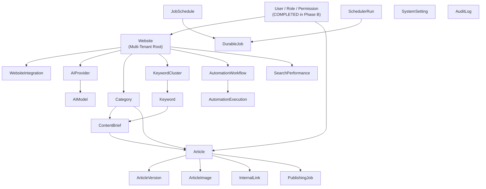

# APEX SEO ENGINE — PHASE C MONGODB DEPENDENCY GRAPH & MIGRATION ORDER

**Date:** 2026-11-14  
**Scope:** Strict dependency hierarchy determining the safe execution sequence for all remaining 21 models.

---

## 1. Topological Dependency Hierarchy

A model cannot be migrated before its foreign key dependencies are established in MongoDB.

---

## 2. Strict Phased Migration Sequence

| Phase | Milestone Name | Models to Migrate | Prerequisites | Dependent Code Modules |
|---|---|---|---|---|
| **Phase C** | Multi-Tenant Root & Integrations | `Website`, `WebsiteIntegration` | `User` (Completed) | `/api/v1/websites`, `/api/v1/integrations` |
| **Phase D** | AI Infrastructure | `AIProvider`, `AIModel` | None | `/api/v1/ai-providers`, `provider-adapter.ts` |
| **Phase E** | Keywords, Clusters & Categories | `Category`, `KeywordCluster`, `Keyword` | `Website` | Keyword research & clustering engines |
| **Phase F** | Content Core & Versioning | `ContentBrief`, `Article`, `ArticleVersion`, `ArticleImage` | `Website`, `Category`, `Keyword`, `User` | `/api/v1/content`, `/p/[websiteId]/[slug]` |
| **Phase G** | SEO Graph & Publishing | `InternalLink`, `PublishingJob` | `Article`, `Website` | `/api/v1/jobs`, CMS publishing adapter |
| **Phase H** | Automation Workflows & Durable Queue | `AutomationWorkflow`, `AutomationExecution`, `DurableJob`, `JobSchedule`, `SchedulerRun` | `Website` | `durable-job-queue.ts`, `job-scheduler.ts` |
| **Phase I** | Analytics, Settings & Audit Logs | `SearchPerformance`, `SystemSetting`, `AuditLog` | `Website`, `User` | `/api/v1/settings`, `audit.ts`, `/api/v1/compliance` |
| **Phase J** | Live Gold Rate Dedicated Cache | `PakistanGoldRate` (Redesigned Mongo cache) | None | `pakistan-gold-rate-service.ts` |
| **Phase K** | Final Retirement & Cleanup | Complete removal of Prisma & PGlite | All models above | `package.json`, `src/lib/db.ts` |
