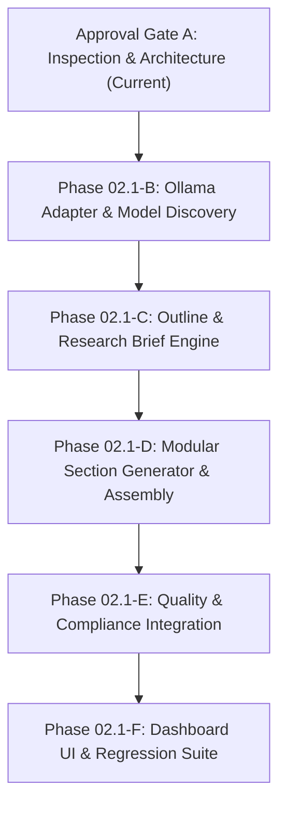

# APEX SEO ENGINE — PHASE 02.1 CODEBASE INSPECTION & ARCHITECTURE GAP ANALYSIS REPORT

**Report Date:** 2026-11-14  
**Target Environment:** Next.js 15.5.29 / React 19 / TypeScript 5.7.2 / PostgreSQL 16 (Prisma 5.22.0)  
**Production URL:** `https://apexseoengine.vercel.app/`  
**Current Production Commit:** `306db87` (verified with full security acceptance & zero data loss)  
**Objective:** Phase 02.1 — Local Ollama AI Integration & AI Article Generation Engine  

---

## 1. Executive Summary

Apex SEO Engine is a deployed, production-grade autonomous publishing and compliance engine. In Phase 01, we established:
1. Multi-tenant database foundation (23 PostgreSQL models via Prisma ORM).
2. Google Search Compliance Engine & AdSense Compliance Engine (5-Gate publishing state workflow).
3. Decoupled Vercel-First Architecture with standalone automation worker (`services/automation-worker`) and a PostgreSQL-backed durable queue (`DurableJob`).
4. Full security hardening (RBAC, JWT session invalidation via `tokenVersion`, mandatory password rotation flag, serverless distributed rate limiting, and zero plaintext secret leakage).

This inspection report reviews all 20 required codebase areas to design **Phase 02.1: Local Ollama AI Integration & AI Article Generation Engine** in strict alignment with the **Zero-Cost Policy**, **Vercel-First Topology**, and **People-First Content Standards**.

---

## 2. Comprehensive Codebase Inventory

### A. Current Architecture
- **Web App / Front-Facing Layer:** Next.js 15 App Router (`src/app/page.tsx` for public magazine, `src/app/p/[websiteId]` for tenant archives, `src/app/p/[websiteId]/[slug]` for long-form reader, and `src/app/admin/page.tsx` for Control Plane).
- **Backend / API Layer:** Next.js route handlers under `src/app/api/v1/` with unified envelopes (`apiSuccess`, `apiError`), Zod schema validation (`parseAndValidateBody`), and RBAC permission checks (`requireApiAuth`).
- **Database & Persistence:** External Managed PostgreSQL 16 accessed via Prisma ORM (`prisma/schema.prisma`). Local development runs embedded PGlite wire-protocol server on `127.0.0.1:5432`.
- **Worker & Async Queue Layer:** `DurableJob` table in PostgreSQL. Workers run decoupled from Vercel Functions (either standalone node process or external cron triggers with HMAC-SHA256 signature verification).

### B. Existing AI Provider Implementation
- **Adapter Factory & Core Logic (`src/services/ai/provider-adapter.ts`):**
  - Defines `AIProviderAdapter` interface with `testConnection()` and `generateText(req: AIGenerationRequest)`.
  - Implements `OllamaAdapter` targeting default `http://localhost:11434` with `/api/tags` connection test and `/api/generate` non-streaming text generation with 30s timeout.
  - Implements `OpenAICompatibleAdapter` for local gateways (vLLM, LM Studio, LocalAI).
  - Factory function `createAIAdapter()` switches by `providerType` (`OLLAMA` / `LOCAL_LLAMA` vs `OPENAI_COMPATIBLE`).
- **Provider API (`src/app/api/v1/ai-providers/route.ts`):**
  - `GET`: Lists all configured providers and models with encrypted API key masking.
  - `POST`: Registers a new AI provider (defaults to Ollama and `llama3.2:latest`).
  - `PATCH`: Supports actions `test_connection`, `add_model`, and `toggle_provider`.

### C. Existing Content Generation Functionality
- **Durable Queue Execution (`src/services/automation/durable-job-queue.ts`):**
  - Job type `AI_ARTICLE_GENERATION` currently accepts an article payload and writes an article draft into PostgreSQL.
  - However, it currently uses a basic template stub instead of invoking the multi-stage AI prompt pipeline.
- **Content Route (`src/app/api/v1/content/route.ts`):**
  - Supports `GET`, `POST` (create article draft), and `PATCH` (update article and record new `ArticleVersion`).
  - Evaluates Google Search Compliance Quality Gate before allowing `PUBLISHED` transition.
- **UI (`src/components/dashboard/DashboardShell.tsx`):**
  - Has tab navigation for `ai-article-writer`, but the form only creates manual drafts and does not yet expose the 7-stage interactive AI outline/section generation pipeline.

### D. Existing Database Models (Reuse Map)
The existing database schema in `prisma/schema.prisma` already possesses the foundational entities needed for Phase 02.1:
1. `AIProvider`: Stores provider type, base URL, encrypted API key, status, and JSON `config`.
2. `AIModel`: Stores model ID, name, capabilities (`["text", "briefs", "seo-optimization"]`), context window, and temperature.
3. `KeywordCluster`: Groups pillar keyword, search intent, and status.
4. `Keyword`: Tracks term, search intent, volume, difficulty, and links to cluster.
5. `ContentBrief`: **Already contains** `title`, `targetWordCount`, `searchIntent`, `outline` (JSON), `secondaryKeywords` (JSON), and `competitorNotes`.
6. `Article`: Stores `title`, `slug`, `excerpt`, `content`, `status`, `focusKeyword`, `metaTitle`, `metaDescription`, `canonicalUrl`, `seoScore`, `wordCount`.
7. `ArticleVersion`: Stores historical snapshots (`versionNumber`, `title`, `content`, `metaTitle`, `metaDesc`, `changeSummary`, `createdBy`).
8. `ArticleImage`: Stores image URL, alt text, prompt, and dimensions.
9. `DurableJob`: Durable background queue supporting `KEYWORD_RESEARCH` and `AI_ARTICLE_GENERATION`.

### E. Existing API Routes
- `/api/v1/ai-providers`: Provider configuration and connection testing.
- `/api/v1/content`: Article draft management and compliance evaluation.
- `/api/v1/compliance`: Detailed SEO & AdSense compliance reports.
- `/api/v1/jobs`: Enqueue and process durable jobs.
- `/api/v1/scheduler/tick`: Automated scheduler triggering.

### F. Existing Test Suites
- 8 test files / 46 passing tests:
  - `tests/unit-security.test.ts`
  - `tests/security-hardening.test.ts`
  - `tests/google-compliance-engine.test.ts`
  - `tests/adsense-and-readiness.test.ts`
  - `tests/api-database.test.ts`
  - `tests/vercel-durable-worker.test.ts`
  - `tests/external-scheduler.test.ts`
  - `tests/gsc-analyzer.test.ts`

---

## 3. Architecture Gap Analysis

| Requirement Area | Existing Phase 01 Capability | Missing / Incomplete Capability for Phase 02.1 |
|:---|:---|:---|
| **Ollama Model Discovery** | `/api/tags` connection test returns names of installed models. | Does not return model details (size, parameter count, quantization); no model availability checker before generation; no structured generation method (`generateStructuredOutput()`); no timeout/concurrency protection on long prompts. |
| **Topic & Cluster Analysis** | `Keyword` and `KeywordCluster` tables exist. | No AI-driven topic analyzer that expands a focus keyword into search intent, secondary keywords, subtopics, entities, and content gap questions. |
| **Article Outline Builder** | `ContentBrief.outline` JSON field exists. | No structured outline builder generating H1/H2/H3 headings with section objectives, suggested tables, image ideas, and internal/external link anchor placeholders. |
| **Multi-Stage Article Generation** | Single monolithic stub in `durable-job-queue.ts`. | Missing modular 7-stage workflow: (1) Research Brief -> (2) Outline Approval -> (3) Section Generation -> (4) Introduction -> (5) Conclusion -> (6) Assembly -> (7) Metadata Generation. |
| **People-First Source Attribution** | Basic links check in technical SEO engine. | No module to distinguish source facts from AI-generated prose, track reference URLs, or mark unverified factual claims as `UNVERIFIED`. |
| **Interactive Article Editor UI** | Simple title/content form in `DashboardShell.tsx`. | No step-by-step wizard showing current generation stage, section-by-section review, outline editor, and live compliance gate findings. |
| **Vercel-to-Worker AI Execution** | Standalone worker can poll `DurableJob`. | Long-running section generations (>15s) would time out on Vercel Functions if executed synchronously. Must run via `DurableJob` queue or external worker with progressive stage tracking. |

---

## 4. Proposed Architecture & Component Design

### 4.1 AI Provider Layer Extensions (`src/services/ai/`)
1. **Extend `AIProviderAdapter` in `src/services/ai/provider-adapter.ts`:**
   - Add `listModelsDetailed()`: Calls Ollama `/api/tags` and extracts model size, quantization family, and modified dates.
   - Add `checkModelAvailable(modelId: string)`: Verifies if a specific model (e.g. `llama3.2`) is loaded/installed.
   - Add `generateStructuredOutput<T>(req: AIGenerationRequest, schema: ZodSchema<T>)`: Uses Ollama JSON mode (`format: "json"`) with Zod schema parsing and automatic 1-retry repair on invalid JSON syntax.
   - Add configurable timeout (default 60s for sections, 20s for outlines) and AbortController cancellation.

### 4.2 Article Generation Pipeline Service (`src/services/ai/article-engine.ts`)
A dedicated, modular pipeline executing 7 distinct stages:
- **Stage 1 (Research Brief):** Analyzes seed topic, focus keyword, and reference URLs. Outputs target audience, user problems, and entity references.
- **Stage 2 (Structured Outline):** Generates outline with H2/H3 sections, section objectives, key takeaway ideas, and table/diagram placeholders.
- **Stage 3 (Section Generation):** Generates each section independently using prompt context chaining (system instructions + outline objective + previous section summary) to maintain voice and avoid repetition.
- **Stage 4 (Introduction):** Crafts hook, problem statement, and learning objectives based on the finalized sections.
- **Stage 5 (Conclusion & Takeaways):** Synthesizes key takeaways, actionable advice, and explicit limitations.
- **Stage 6 (Assembly & Traceability):** Combines sections into valid semantic HTML/Markdown, inserting source citations or flagging unverified claims.
- **Stage 7 (Metadata & SEO Tags):** Generates click-worthy, Google-compliant meta title, meta description, and URL slug.

### 4.3 Database Schema Considerations
- **No new required tables:** The existing `ContentBrief`, `Article`, `ArticleVersion`, `Keyword`, `AIProvider`, `AIModel`, and `DurableJob` models are already sufficient.
- **Additive optional fields:**
  - `ContentBrief`: `researchNotes` (Json?), `sources` (Json?) — can be stored directly inside existing `outline` and `competitorNotes` or via additive migration if strictly necessary.
  - To maintain maximum migration safety, we can store structured outline stages inside `ContentBrief.outline` (Json) and version histories in `ArticleVersion`.

### 4.4 API Routes (`src/app/api/v1/`)
- `POST /api/v1/content/outline`: Generates and validates research brief & structured outline.
- `POST /api/v1/content/generate-section`: Generates or regenerates an individual outline section.
- `POST /api/v1/content/assemble`: Assembles sections, runs Google Search & AdSense compliance gates, and saves as versioned `DRAFT`.
- `GET /api/v1/ai-providers/models`: Discovers available models from local Ollama or worker endpoint.

---

## 5. Implementation Sequence & Approval Gates

1. **PHASE 02.1-B (Ollama Integration):**
   - Enhance `OllamaAdapter` with detailed model listing, JSON structured output mode, and robust timeout handling.
   - Unit tests with mock Ollama server for CI compatibility.
2. **PHASE 02.1-C (Topic Cluster & Outline Builder):**
   - Implement `article-engine.ts` (Stages 1 & 2).
   - Create `/api/v1/content/outline` route.
   - Unit tests verifying structured outline generation and search intent alignment.
3. **PHASE 02.1-D (Section Generation & Assembly):**
   - Implement Stages 3–7 in `article-engine.ts`.
   - Connect to `ArticleVersion` snapshots.
   - Unit tests verifying section assembly and recovery.
4. **PHASE 02.1-E (People-First Quality & Compliance Integration):**
   - Connect generated drafts to `evaluateGoogleSearchComplianceGate` and `evaluateAdSenseCompliance`.
   - Flag unverified factual claims and enforce human approval on YMYL topics.
5. **PHASE 02.1-F (Dashboard UI Integration & End-to-End Release):**
   - Enhance `DashboardShell.tsx` `ai-article-writer` tab with an interactive 4-step wizard (Topic -> Outline Review -> Section Generation -> Quality Gate).
   - Execute full automated regression test suite and production build check.

---

## 6. Risks & Mitigation

1. **Risk:** Local Ollama inference can exceed standard Vercel Function execution timeouts (15–30s) if large articles are generated in a single HTTP request.  
   **Mitigation:** The system generates content section-by-section (each HTTP request generates 1 section in 3–8s), or delegates long-form batches to the decoupled background worker (`DurableJob`).
2. **Risk:** Hallucinated factual claims or fabricated references.  
   **Mitigation:** The People-First Content Engine requires explicit user-provided reference URLs or marks claims as `UNVERIFIED_SOURCE` requiring editorial review.
3. **Risk:** Model absence on user machine.  
   **Mitigation:** Provider checks `/api/tags` and verifies `llama3.2` presence; if missing, returns structured error listing available models without silently downloading large files.
